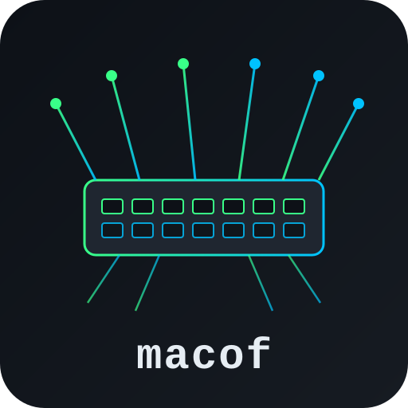

<div align="center">
  

  # macof — MAC Flooding Attack Notes

  Catatan pembelajaran tentang MAC flooding attack menggunakan `macof` di Kali Linux.

  
  
  
</div>

---

## ⚠️ Disclaimer

Repo ini dibuat **murni untuk tujuan edukasi** (belajar keamanan jaringan, persiapan sertifikasi seperti OSCP/CEH, atau riset di lab pribadi). Teknik di dalamnya **hanya boleh dipraktikkan pada jaringan milik sendiri atau yang sudah mendapat izin eksplisit untuk diuji**. Penggunaan tanpa izin pada jaringan pihak lain melanggar hukum.

## 📖 Tentang macof

`macof` adalah tool dari paket **dsniff** yang digunakan untuk melakukan **MAC flooding attack** — membanjiri switch dengan ribuan alamat MAC palsu per detik hingga tabel **CAM (Content Addressable Memory)** penuh.

Ketika CAM table overflow, sebagian switch (khususnya yang lama atau tanpa proteksi) akan **fail open** dan mulai berperilaku seperti hub: broadcast semua traffic ke seluruh port alih-alih hanya ke port tujuan. Kondisi inilah yang dimanfaatkan untuk mempelajari risiko sniffing pada jaringan switched.

## 📦 Instalasi

```bash
sudo apt update
sudo apt install dsniff
```

## 🚀 Penggunaan

```bash
sudo macof -i <interface>
```

| Opsi | Keterangan |
|------|------------|
| `-i` | Interface jaringan (misal `eth0`) |
| `-s` | IP sumber tertentu |
| `-d` | IP tujuan tertentu |
| `-e` | MAC address tujuan tertentu |
| `-x` | Port sumber |
| `-y` | Port tujuan |
| `-n` | Jumlah paket yang dikirim |

Contoh:

```bash
sudo macof -i eth0
sudo macof -i eth0 -d 192.168.1.10
sudo macof -i eth0 -n 1000
```

## 🧪 Alur Kerja di Lab

1. Pastikan berada di jaringan lab/isolasi yang sah untuk diuji.
2. Jalankan Wireshark/`tcpdump` sebagai baseline traffic normal.
3. Jalankan `macof -i eth0` untuk membanjiri CAM table switch target.
4. Amati apakah traffic host lain mulai bocor ke port penyerang.
5. Hentikan dengan `Ctrl + C`.
6. Dokumentasikan hasil pengujian.

## 🛡️ Mitigasi

- **Port Security** — membatasi jumlah MAC address per port.
- **DHCP Snooping**
- **Dynamic ARP Inspection (DAI)**
- **VLAN segmentation**
- Monitoring utilisasi CAM table secara berkala.

## 📚 Referensi

- [dsniff — monkey.org](https://www.monkey.org/~dugsong/dsniff/)
- [Kali Tools: dsniff](https://www.kali.org/tools/dsniff/)

---

<div align="center">
  <sub>Dibuat untuk tujuan edukasi keamanan jaringan.</sub>
</div>
